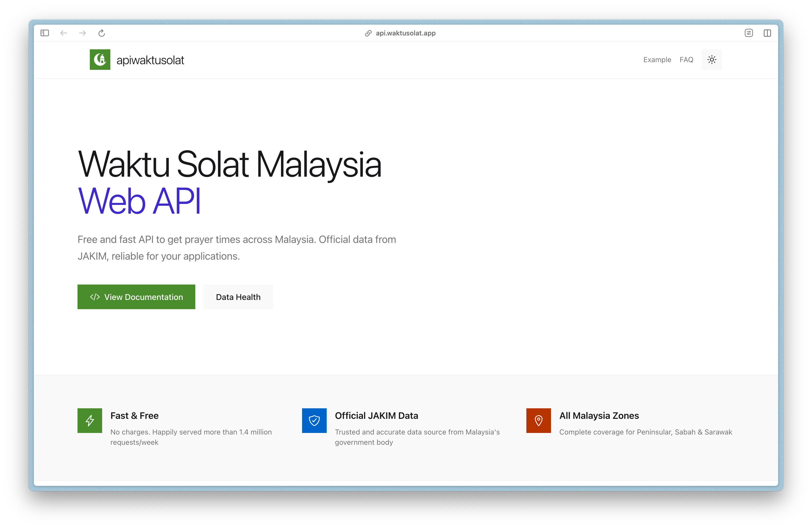
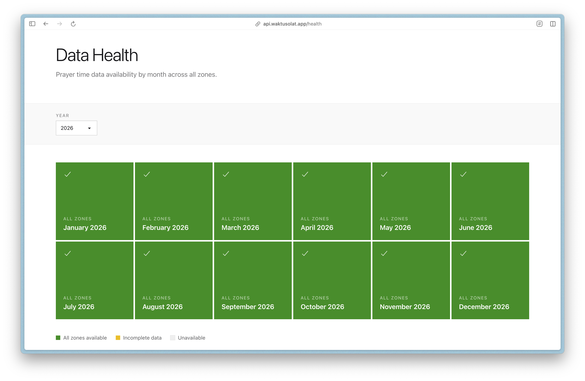
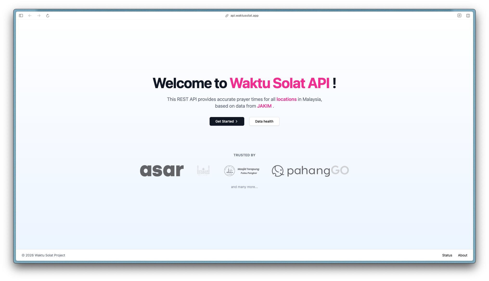

Few days ago, while I was browsing the [API Waktu Solat](https://api.waktusolat.app/) website, I suddenly had this thought to myself, "Wouldn't hurt for a bit of a visual refresh, would it?" The website looks the same after several years. To keep it fresh, I decided to give the homepage a new look, but I wasn't sure about the design direction yet.

So I browsed through [Dribbble](https://dribbble.com/) for some inspiration, there are a few that caught my attention, but every one of them I had minor complaint about. Example: "This looks a bit messy", "This looks AI generated", "This feels bla bla bla...". I couldn't find a suitable candidate for an API server homepage.

After a few minutes contemplating, I remembered that I really like old Windows Phone UI. The design had a special place in my heart even though I never own the device. I once dreamed to have a Lumia phone. The UI is so ahead of its time, I would say, and [others](https://v0.app/chat/nokia-lumia-api-d0XTz86TRFu) [agreed](https://www.reddit.com/r/windowsphone/comments/7fxs69/opinion_windows_phone_has_the_best_ui) too. So I decided to take inspiration from that design language.

<figure class="mx-auto w-full max-w-3xl">
    
<figcaption class='text-center'>Photo by JÉSHOOTS: https://www.pexels.com/photo/apps-digital-hand-media-4957/</figcaption>
</figure>

I asked [v0](https://v0.app/) to create a [mockup](https://v0.app/chat/nokia-lumia-api-d0XTz86TRFu) using this aesthetic. It did nicely and I tweaked a bit here and there in the final version. Here is the result of the redesign, I hope you like it.

<figure>

<figcaption class='text-center'>New homepage design</figcaption>

</figure>

<figure>

<figcaption class='text-center'>The health page</figcaption>

</figure>

To recap, this is the old homepage screen that I had since 2023:

<figure>

<figcaption class='text-center'>Old homepage design for API Waktu Solat</figcaption>

</figure>

References:

- https://api.waktusolat.app/
- https://github.com/mptwaktusolat/api-waktusolat-x/pull/50
